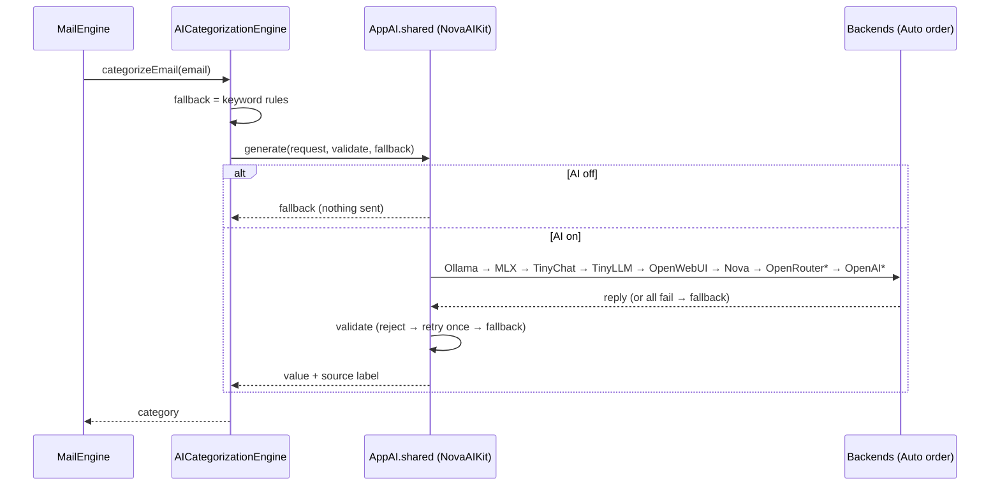
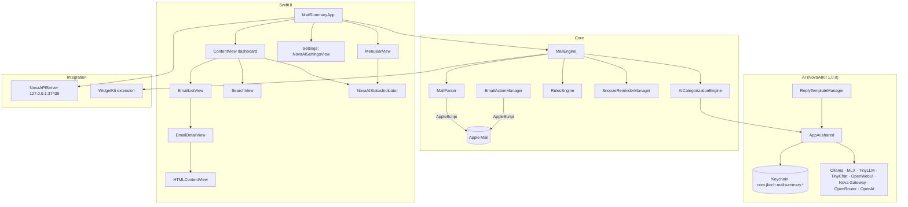

# Mail Summary

**A macOS inbox dashboard for Apple Mail: it reads your mailbox, sorts every message into a category, scores its
priority, and writes a short summary of what needs attention. AI is optional; with AI off or unreachable, every
feature still works from built-in rules.**


Current version: **3.1.0 (build 14)** · [Changelog](CHANGELOG.md)

---

## Features

### In the app today

| Feature | What it does |
|---|---|
| **Inbox dashboard** | Scans Apple Mail (AppleScript, read-only metadata first, bodies loaded on demand) and shows unread, today, high-priority and action-item counts, grouped by category. |
| **Categorization** | Every message is filed as Bills, Orders, Work, Personal, Marketing, Newsletters, Social, Spam or Other. AI reads the content; the built-in path uses subject/sender keywords. |
| **Priority scoring** | 1–10 importance per message (deadlines, payments, meetings, urgency). AI or rule-based. |
| **Mailbox summary** | A 2–3 sentence "what needs attention" card, labelled with where it came from (`AI · Ollama (qwen3:8b)` or `Built-in`). |
| **Search** | Full-text search with category, priority, date-range, unread and regex filters, plus saved presets. |
| **Email detail** | Sanitised HTML rendering (JavaScript disabled, CSP), quick actions (delete, archive, mark read/unread, reply and forward in Mail), snooze and reminders. |
| **Snooze & reminders** | Hide a message until later, get a reminder banner when it's due. |
| **Rules engine** | Saved condition → action rules (category, sender, keywords, priority) applied on every scan. |
| **Background scan** | Optional auto-scan interval with a notification for new high-priority mail. |
| **Menu bar extra** | Unread/high-priority counts, Scan Now, AI status, AI Settings. |
| **Widget** | WidgetKit extension (small, medium, large) with the latest counts. |
| **AI settings** | One standard settings pane (NovaAIKit): AI on/off, backend and model pickers, editable URLs, Keychain-only keys, test connection. |
| **Local API** | Loopback-only HTTP API on port 37439 for Nova / Claude Code (`/api/status`, `/api/ping`). |

### Built, not yet reachable from the UI

These engines and views compile and are covered by tests, but no screen links to them yet: thread grouping,
quick-reply templates with AI-tailored and smart replies, sender intelligence, analytics and insights dashboards,
the rules editor, duplicate detection, PII redaction, export/backup, Calendar/Reminders/Notes/webhook integrations, and the theme
editor. They use the same AI layer and fallbacks described below once wired in.

---

## AI

Mail Summary's AI runs on **[NovaAIKit 1.0.0](https://github.com/kochj23/NovaAIKit)**, the shared AI layer used by
every Jordan Koch macOS app. The app keeps its own prompts, validators and built-in fallbacks; NovaAIKit handles
backends, failover, retries, keys and status.

**Backends** (Settings → AI, or the menu bar's *AI Settings…*):

| Backend | Default URL | Notes |
|---|---|---|
| Auto | — | Tries every configured backend in a fixed order (local first) and uses the first that answers. |
| Ollama | `http://localhost:11434` | Recommended. Local, free, private. |
| MLX | `http://localhost:8081` | Apple Silicon, `mlx_lm.server`. |
| TinyLLM / TinyChat | `http://localhost:8000` | By Jason Cox. |
| OpenWebUI | `http://localhost:8080` | Optional API key. |
| Nova Gateway | `http://127.0.0.1:18792` | Nova's gateway or any OpenAI-compatible fleet router. |
| OpenRouter | `https://openrouter.ai/api/v1` | Frontier models with one key. https only. |
| OpenAI | `https://api.openai.com/v1` | https only. |

- **AI on/off.** "Use AI" off means nothing leaves your Mac; every feature uses its built-in result.
- **Auto failover** with per-request timeouts and bounded retries; an endpoint that just failed is skipped for a minute.
- **Validation.** Every AI reply is checked before it's used. A rejected reply is retried once with the reason, then
  the built-in result is used.
- **Keys** live only in the macOS Keychain, under `com.jkoch.mailsummary.<backend>` (account `apiKey`), and are only
  ever sent over https. The settings pane shows a key as *stored*, never as text.
- **Status indicator** in the dashboard header and the menu bar: green online (backend + model), orange unreachable,
  grey off. Click to re-check.

### Fallback and validation per feature

| Feature | AI output | Validator | Built-in fallback |
|---|---|---|---|
| Categorization | JSON `{"category": …}` | Must be one of the nine categories | Subject/sender keyword rules |
| Priority | JSON `{"priority": n}` | Numeric, clamped to 1–10 | Urgency/payment/meeting rules |
| Mailbox summary | Plain text | Non-empty, ≤ 400 chars, plain text, **no numbers that aren't in the mailbox counts** | Template from the counts |
| Single-email summary | Plain text | Non-empty, ≤ 400 chars | First two sentences of the body |
| Action items | JSON list | ≤ 10 items, non-empty text, known types | Keyword lines (due / meeting / please…) |
| Sender importance | JSON `{"importance": x}` | Clamped to 0–1 | Open rate ± category |
| Actionable factors | JSON flags + urgency | Urgency clamped to 0–1 | Keyword flags |
| Natural-language search | JSON filters | Known categories only, priority 1–10 | Keyword filter extraction |
| Insights | JSON digest/trends/recommendations | Digest required, priorities 1–10, confidence 0–1, ≤ 5 each | Counts-based digest and recommendations |
| Template tailoring / smart reply | Plain text | Non-empty, ≤ 2000 chars, no unfilled `{{placeholders}}` | The filled-in template / a polite acknowledgement |

### Upgrading from 3.0

On first launch 3.1 migrates the old AI settings once: backend, URLs, Ollama model and on/off from the old
`AIBackend_*` defaults and the old load balancer's `ms.llm.*` defaults. A plaintext OpenAI key in UserDefaults is
moved into the Keychain and removed from UserDefaults (**security fix**). Keys in the old Keychain items
(`com.jkoch.aistudio.aibackend`, `com.jkoch.aistudio.openrouter`) are copied to `com.jkoch.mailsummary.*`; those
shared items are left in place for other apps. Google Cloud, Azure, AWS and IBM Watson backends were dropped; their
stored secrets are deleted, along with the old AI-guardian prompt log and usage stats.


<sub>* only with a Keychain key, https only.</sub>

---

## Architecture



| Path | Contents |
|---|---|
| `Mail Summary/MailEngine.swift` | Scan pipeline, parallel categorization batches, stats, auto-scan |
| `Mail Summary/AICategorizationEngine.swift` | Prompts, validators and built-in rules for every AI feature |
| `Mail Summary/AI/AppAI.swift` | The single `NovaAI` instance and the one-time legacy migration |
| `Mail Summary/Managers/` | Rules, actions, snooze, search, threads, templates, analytics, export, integrations, PII |
| `Mail Summary/Views/` | SwiftUI screens and components |
| `Mail Summary Widget/` | WidgetKit extension |
| `Mail SummaryTests/` | XCTest suite |

---

## Requirements

- macOS 14 Sonoma or later (Apple Silicon or Intel)
- Apple Mail with at least one account; grant Automation access to Mail on first scan
- Optional, for AI: a local Ollama (`brew install ollama && ollama pull qwen3:8b`), MLX, TinyLLM/TinyChat,
  OpenWebUI or Nova Gateway, or an OpenRouter/OpenAI key
- To build: Xcode 27 or later (Swift Package Manager resolves NovaAIKit from GitHub)

## Install

1. Open `MailSummary-v3.1.0-build14.dmg` and drag **Mail Summary** onto **Applications**.
2. Launch it and click **Scan Now**; allow Mail Summary to control Mail when macOS asks.
3. Optional: **Mail Summary → Settings…** (⌘,) to choose an AI backend, or turn AI off.

Release builds are ad hoc signed for local use.

## Build from source

```bash
git clone git@github.com:kochj23/MailSummary.git
cd MailSummary
xcodebuild -project "Mail Summary.xcodeproj" -scheme "Mail Summary" -configuration Release \
  -derivedDataPath ./dd build
```

## Tests

```bash
xcodebuild test -project "Mail Summary.xcodeproj" -scheme "Mail Summary" -destination 'platform=macOS' -derivedDataPath ./dd
```

197 tests, all passing. Every AI test uses an in-memory settings store, an in-memory key store and a stub
URLSession: no real Keychain, network or mail content. Fixtures are synthetic (`example.com`).

| Suite | Tests | Coverage |
|---|---|---|
| AISecurityTests | 5 | Keychain service names, plaintext-key migration, legacy Keychain migration + obsolete-secret deletion, no keys over http, no legacy AI client in sources |
| AIPerformanceTests | 2 | Offline fallback doesn't hang, rule speed |
| AIRetryTests | 2 | Rejected reply → one corrective retry → fallback; bounded retry policy |
| AIUnitTests | 9 | Every validator and built-in rule |
| AIIntegrationTests | 2 | Valid replies flow through NovaAIKit with source labels; legacy settings migration (idempotent) |
| AIFunctionalTests | 2 | Every AI feature with AI off and with every backend down |
| AIFrameTests | 3 | Status states (off/offline/online), settings + indicator views render |
| LoadBalancerTests | 8 | Failover order, extra Ollama endpoints, dedup, key gating, health TTL (NovaAIKit) |
| SecurityTests | 15 | Credential scanning, Keychain-only keys, XSS/CSP, phishing patterns |
| EmailModelsTests | 15 | Email model, categories, actions, Codable |
| MailParserTests | 16 | Header, sender, metadata and date parsing |
| ThreadGroupingTests | 22 | Subject normalization, thread building |
| PIIRedactionTests | 25 | SSN, card, phone, email, address detection and redaction |
| SearchFilterTests | 30 | Filters, regex validation, presets |
| AnalyticsModelsTests | 23 | Daily/sender stats, trends, recommendations |
| IntegrationTests | 18 | Thread, search, snooze and priority workflows |

## Security & privacy

- Mail is read locally through AppleScript; nothing is uploaded unless you pick a remote AI backend.
- With AI off, no request leaves the Mac. Local backends (Ollama, MLX, TinyLLM, TinyChat, OpenWebUI) keep mail on
  your machine or LAN.
- API keys: Keychain only, never in UserDefaults, files or logs; cloud keys only over https.
- HTML mail is rendered with JavaScript disabled and a restrictive CSP.
- The local API binds to 127.0.0.1 only.

See [SECURITY.md](SECURITY.md) to report a vulnerability.

## Nova / Claude Code API

Loopback-only HTTP server on **127.0.0.1:37439**, started with the app:

```bash
curl -s http://127.0.0.1:37439/api/status   # {"status":"running","app":"MailSummary","version":"3.1.0",…}
curl -s http://127.0.0.1:37439/api/ping
```

## Changelog

See [CHANGELOG.md](CHANGELOG.md).

## More apps by Jordan Koch

| App | Description |
|-----|-------------|
| [NewsSummary](https://github.com/kochj23/NewsSummary) | AI-powered news aggregation and summarization |
| [JiraSummary](https://github.com/kochj23/JiraSummary) | AI-powered Jira dashboard with sprint analytics |
| [MBox-Explorer](https://github.com/kochj23/MBox-Explorer) | macOS mbox email archive viewer |
| [MLXCode](https://github.com/kochj23/MLXCode) | Local AI coding assistant for Apple Silicon |
| [NovaAIKit](https://github.com/kochj23/NovaAIKit) | The shared AI layer these apps use |

> **[View all projects](https://github.com/kochj23?tab=repositories)**

## License

MIT. See [LICENSE](LICENSE).

> **Disclaimer:** This is a personal project created on my own time. It is not affiliated with, endorsed by, or
> representative of my employer.
